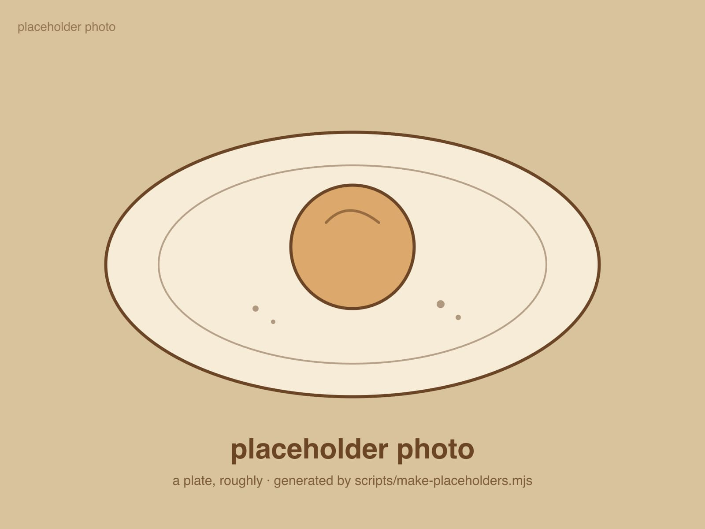

*(Placeholder post. It is here so the pages have something to hold until the real writing arrives.)*

This is what a post looks like with a cover photo at the top and one more photo further down. Paragraphs are set at a comfortable size for reading on a phone, with enough space between them that a longer piece does not feel dense.

The text here is deliberately plain. The point is to judge the layout, the type, and how photos sit in the flow, not the words.

A photo inside the writing takes the full width of the column and keeps its proportions. Below it the text simply continues.

That is the whole shape of a post: title, a line of context, the writing, and a place for comments at the end.
