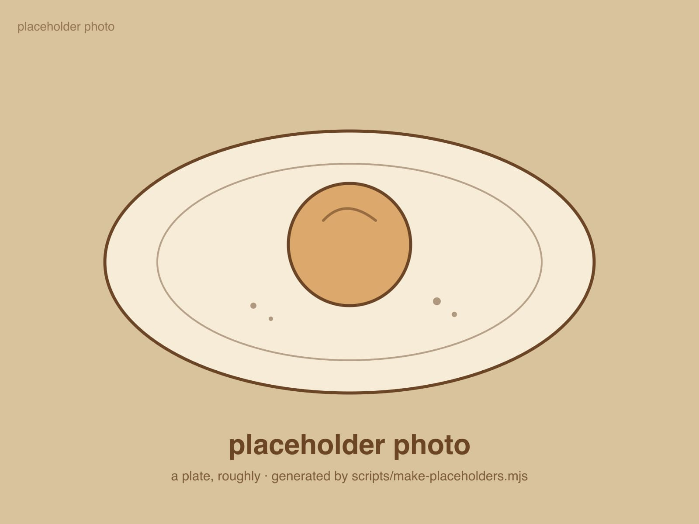

*(Example post. The photos are stand-ins.)*

I've made this focaccia three times now from the same recipe, and each time it has come out a little different, which I've decided is the point rather than a problem.

The first time I rushed the second rise. The dough went into the oven looking fine and came out dense, with a crust that was more of a shell. Edible, but not what I wanted. The second time I waited the full two hours and it was better, airier, though I under-salted the top and spent the rest of the week adding salt at the table.

This time I did two things differently. I used less flour than the recipe says, so the dough was looser and harder to handle but much more open once baked. And I let it sit in the fridge overnight before the final rise, mostly because I ran out of evening, which turned out to be the best decision of the three.

It isn't perfect. The middle is still a touch tighter than the edges, and I think the oven runs cooler than it claims. But it's the first one I'd put in front of someone without explaining it first.

Next time: more oil in the pan, and I want to try rosemary from the plant on the windowsill before it gives up for the winter.
